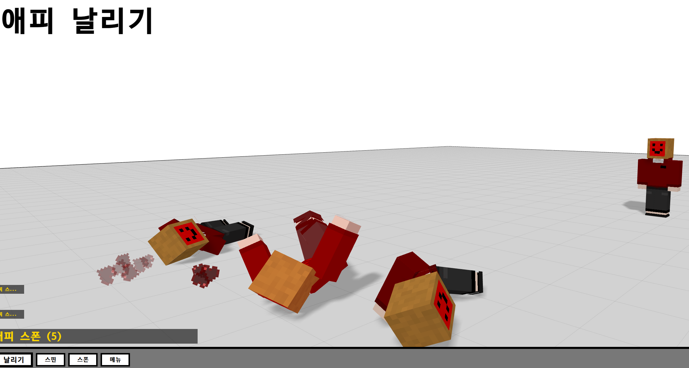

# 애피 날리기 — AppieRagdoll
뭐네어쩌라고요제가AiSlop만든다는데막그렇게절뭐라할거에요?!?!?!?!

## 실행

이 Ai Slop도 고급진 Wifi가 필요합니다. (three.js / cannon-es CDN 사용).

- https://muffler-2597.github.io/AppieRagdoll/ 접속, 또는
- `python -m http.server 8000` 후 http://localhost:8000/Appie-ragdoll.html 접속

## 조작

| 입력 | 동작 |
|---|---|
| 드래그 | 애피 잡고 던지기 |
| WASD | 카메라 이동 (Shift 가속) |
| 우클릭 드래그 | 시점 회전 |
| 휠 | 앞뒤 이동 |
| TAB / ESC | 메뉴 열기·닫기 |
| R / F / M | 스폰 / 날리기 / 효과음 토글 |
| Ctrl+Z / Ctrl+Y | 오브젝트 되돌리기·다시 실행 |
| Enter (스킨란) | 스킨 적용 |

## 기능

- **스킨**: 직접 수정 가능
- **물리**: 레그돌이라고
- **스테이지**: 64×64 아래 판때기
- **오브젝트**: 네 뭐 해보세요
- **녹화**: GIF / MP4 최대 3분
- **설정**: 강도·그림자·효과음·화면 흔들림·토스트, localStorage 저장

## 스택

- [GolaCSS](https://github.com/Muffler-2597/GolaCSS) (온라인 CDN, 업데이트 연동) <-- 가장 중요함ㅇㅇ 

